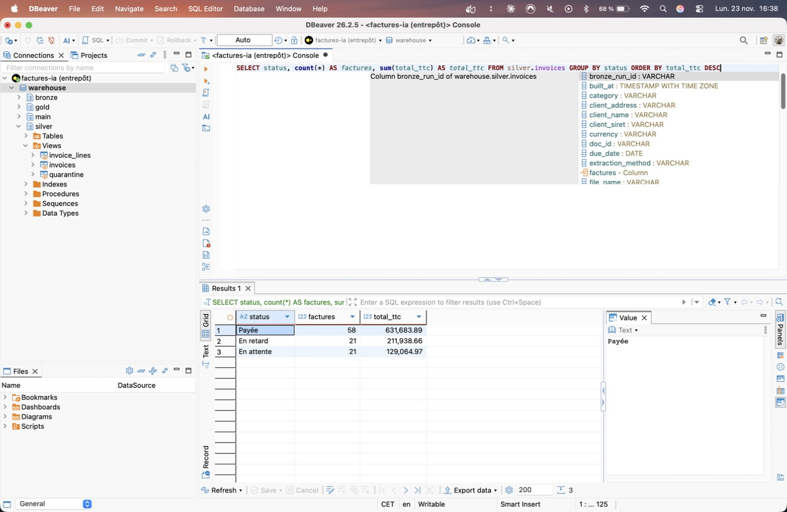
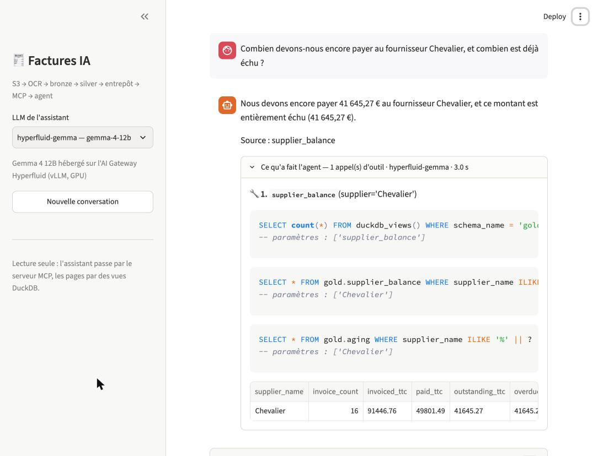
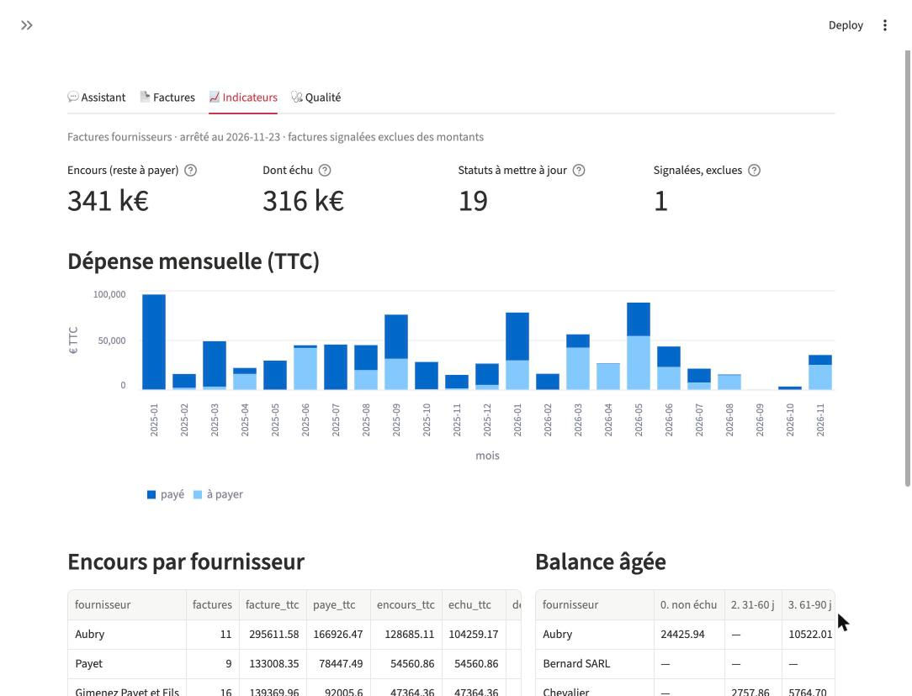

# De la facture scannée à l'agent IA

<p class="meta">Rapport de projet · <b>Tom Cantillon</b> · 23 novembre 2026<br>
Dépôt : <code>github.com/Tom-Cantillon/factures-ia</code> · lancement : <code>README.md</code></p>

<div class="callout">
<b>En bref</b>
<ul>
<li>Une chaîne complète et reproductible : S3 → OCR → bronze → silver → gold → SQL → serveur MCP → agent.</li>
<li>100 factures traitées : 50 par leur couche texte, 50 par OCR. Une anomalie volontaire détectée.</li>
<li>OCR exact sur <b>100 % des 70 factures évaluées</b> à la résolution recommandée (1540 px).</li>
<li>« Montant TTC des factures en retard en 2025 ? » → <b>106 886,43 €</b>, même réponse avec un LLM hébergé et un LLM local, vérifiée par SQL.</li>
<li>45 tests automatisés, lancés à chaque push par la CI.</li>
</ul>
</div>

## 1. Architecture

```
 S3 "factures" ─► landing ─► texte ou image ? ─┬─ couche texte (PyMuPDF) ──────┐
                                               └─ OCR LightOnOCR-3 (Hyperfluid) ┤
                                                                                ▼
   BRONZE   texte brut + traçabilité       (Parquet, jamais modifié)
   SILVER   factures, lignes, quarantaine  (typé, contrôlé)
   GOLD     dépenses, encours, balance âgée
                                                                                ▼
   ENTREPÔT  vues DuckDB sur les Parquet   ◄── DBeaver
                                                                                ▼
   SERVEUR MCP  7 outils en lecture seule, SQL renvoyé
        │                       │                        │
      agent (LLM au choix)    Claude Code / Desktop    interface web
```

### Choix techniques

| Brique | Choix | Pourquoi |
|---|---|---|
| Environnement | Python 3.13 + **uv** | installation reproductible en une commande (`uv.lock`) |
| Lecture des PDF | PyMuPDF | couche texte, détection des images, rendu PNG pour l'OCR |
| OCR | LightOnOCR-3, client OpenAI | API standard ; une interface `OcrEngine` permet de changer de moteur |
| Stockage | **Parquet** | typé, compact, immuable, lisible par tous les moteurs SQL |
| Calcul SQL | **DuckDB** | sans serveur, lit Parquet directement, pilote DBeaver |
| Accès IA | SDK officiel **MCP** | protocole standard, en local (stdio) ou en réseau (HTTP) |
| LLM | API « chat completions » | parlée par vLLM, Ollama, OpenAI… : le LLM devient un réglage |
| Interface | Streamlit | uniquement du Python, réutilise l'agent et l'entrepôt |

## 2. Les couches de données

### Bronze : ce qu'on a lu

- **Identité = empreinte du contenu** (SHA-256), pas le nom du fichier. Relancer ne retraite rien et ne fait **aucun appel OCR**.
- **Jamais modifiée** : on garde le texte brut, la méthode, le modèle et les réglages OCR, et l'exécution qui l'a produit. N'importe quel montant remonte à son PDF.
- **Tolérante aux pannes** : 3 essais, un coupe-circuit, chaque échec journalisé puis retraité au run suivant. Testé avec une panne simulée.

### Silver : ce qu'on croit vrai

- **Un seul parseur** pour deux formes de texte : texte natif et markdown de l'OCR sont d'abord ramenés au même format.
- **Montants en décimal exact**, jamais en nombre flottant, qui fausse les centimes.
- **Rejeter ou signaler** :
  - *rejet* (quarantaine) : facture inexploitable ou en double ;
  - *signalement* : facture gardée, anomalie notée (totaux incohérents, IBAN invalide…).
- **Rien n'est corrigé automatiquement** : un montant recalculé masquerait l'erreur.

<div class="callout">L'anomalie glissée dans le jeu est détectée : <b>V-2025-0001</b> affiche un TTC de 99 999,99 € pour HT 148,26 € + TVA 29,65 €. Vérifié sur l'image : l'erreur est dans le document, pas dans l'OCR.</div>

### Gold : indicateurs métier (bonus)

- Dépense mensuelle, encours par fournisseur (**341 003,63 €** à payer) et balance âgée.
- Factures signalées exclues des montants, mais comptées à part.
- Le retard se calcule sur l'échéance : **19 factures « En attente » sont en réalité échues**.

### Entrepôt : stockage séparé du calcul

- L'entrepôt ne contient que des **vues** sur les Parquet : les données n'existent qu'en un exemplaire.
- Chaque programme ouvre sa propre base DuckDB **en mémoire**. DBeaver ouvre un petit fichier de vues. Résultat : DBeaver ne bloque jamais le pipeline (vérifié).

<div class="figs single">
<figure><figcaption>DBeaver connecté à l'entrepôt en lecture seule (<code>access_mode = READ_ONLY</code>) : schémas bronze, silver et gold, et une requête sur <code>silver.invoices</code>.</figcaption></figure>
</div>

## 3. Le serveur MCP

- **7 outils** : lister, totaliser, détailler une facture, dépense mensuelle, encours, schéma, SQL libre.
- **Transparence** : chaque réponse contient le SQL exécuté et ses paramètres.
- **Sécurité** : les valeurs venant du LLM passent en paramètres séparés, jamais collées dans le SQL. Le SQL libre est protégé par **4 barrières** :
  1. une seule instruction, et seulement un `SELECT` ;
  2. une connexion neuve et jetable à chaque appel ;
  3. le bac à sable de DuckDB : aucun fichier hors de l'entrepôt ;
  4. un maximum de lignes et de temps.
- **Erreurs utiles** : le message donne les valeurs permises ou les colonnes proches, pour que le LLM se corrige.

<div class="callout">Testé avec un vrai client MCP : chaque outil vérifié, et <b>12 attaques refusées</b> (DROP, COPY, lecture de fichiers…). Le bac à sable seul laissait passer un <code>COPY</code> : la barrière 1 est indispensable.</div>

## 4. Évaluation de l'OCR

**Deux vérités terrain** :
- **20 vrais scans** tirés au sort, chaque champ vérifié à la main sur l'image ;
- **50 faux scans** fabriqués à partir des PDF natifs (flou, bruit, rotation), dont la vérité est exacte et gratuite.

| Factures exactes à 100 % | 512 px | 768 px | **1540 px** |
|---|---:|---:|---:|
| Vrais scans (20) | 0/20 | 18/20 | **20/20** |
| Faux scans (50) | 0/50 | 4/50 | **50/50** |
| Temps par page | ≈ 6 s | ≈ 5 s | ≈ 8 s |

<div class="callout"><b>À retenir</b>
<ul>
<li>La résolution recommandée par la fiche du modèle est <b>décisive</b> : en dessous, le modèle invente des valeurs plausibles.</li>
<li>Champs fragiles : les longues suites de chiffres (IBAN, SIRET), les noms propres, la structure des tableaux.</li>
<li>Les contrôles de la silver repèrent <b>39 des 46</b> factures mal lues à 768 px.</li>
<li>20 factures exactes sur 20 ne prouvent qu'un taux d'au moins 83 % environ : d'où l'intérêt des faux scans.</li>
</ul></div>

## 5. L'agent

- Il **ne voit les données qu'à travers le serveur MCP**.
- Il **affiche** chaque outil appelé, le SQL et le résultat, garde le fil de la conversation et s'arrête proprement.
- Le **LLM se change par configuration** (`--llm`), sans toucher au code.

**Ne pas inventer de chiffres**, en trois niveaux :
1. le prompt impose de recopier les valeurs des outils ;
2. les calculs **et les classements** sont faits en SQL ;
3. une **vérification automatique** contrôle que chaque chiffre de la réponse figure dans un résultat d'outil. Sinon, le LLM corrige ou un avertissement s'affiche.

### Mêmes questions, quatre LLM

11 questions, dont une qui fait appel à la mémoire de la conversation, deux sur les indicateurs gold et deux qui obligent à écrire son propre SQL. Les bonnes réponses sont calculées par une requête SQL directe sur l'entrepôt (`uv run factures agent-bench`).

| | Gemma 12B | Granite 8B | Nemotron E4B | Ministral 8B |
|---|---:|---:|---:|---:|
| Hébergé ou local | Hyperfluid | Hyperfluid | Hyperfluid | Mac (Ollama) |
| 9 questions avec un outil dédié | 9/9 | 9/9 | 9/9 | 9/9 |
| 2 questions en SQL libre | 2/2 | 2/2 | 0/2 | 1/2 |
| **Total** | **11/11** | **11/11** | **9/11** | **10/11** |
| Temps total | 30 s | 33 s | 16 s | 141 s |

<div class="callout"><b>À retenir</b>
<ul>
<li><b>Avec des outils dédiés, même un modèle de 8B suffit</b> : les quatre font un sans-faute.</li>
<li><b>Le SQL libre sépare les modèles</b> : Nemotron refuse poliment, Ministral répond parfois à côté.</li>
<li><b>Un prompt ne suffit pas</b> : Granite avait recopié 41 645,27 € en 416 645,27 € et pris le mauvais fournisseur. Le tri par la base et la vérification des chiffres ont corrigé les deux.</li>
<li>Le modèle local est <b>4 à 10 fois plus lent</b>.</li>
</ul></div>

<div class="figs">
<figure><figcaption>L'assistant : la réponse, l'outil appelé et le SQL exécuté.</figcaption></figure>
<figure><figcaption>Les indicateurs gold : encours, échu, dépense mensuelle.</figcaption></figure>
</div>

## 6. Industrialisation

5 000 factures par mois représentent environ **1 h 30 d'OCR** : le volume n'est pas le problème. Les vrais enjeux sont la sécurité, la fiabilité et l'exploitation.

| Priorité | Pourquoi | Mesures |
|---|---|---|
| 1. Sécurité | IBAN et données financières | secrets en coffre, droits minimaux, authentification du MCP, défense contre l'injection de prompt |
| 2. Automatisation | traiter les factures dès leur arrivée | déclenchement par événement ; sûr car le pipeline ne refait jamais deux fois le même travail |
| 3. Montée en charge | pics de fin de mois | plusieurs serveurs d'OCR, stockage S3 au format Iceberg |
| 4. Non-régression | changer de modèle sans risque | évaluation OCR et banc d'essai des LLM en seuils bloquants |
| 5. Supervision | savoir quand ça casse | taux de factures signalées par fournisseur, latence OCR |

**Déjà en place** : image Docker, `docker compose` (pipeline, serveur MCP en HTTP en lecture seule, interface), CI GitHub et interface web. Le détail est dans `docs/INDUSTRIALISATION.md`.

## 7. Difficultés, limites et pistes

**Difficultés**
- Clé d'API au mauvais scope (refus 403), Python 3.15 trop récent, API de MCP et de DuckDB qui avaient changé.
- Les SIRET du jeu sont fictifs : leur clé de contrôle aurait signalé toutes les factures.
- Les LLM recopient parfois mal un chiffre : il a fallu une vérification par programme.

**Limites**
- Le parseur suppose les 8 mises en page du jeu fourni.
- 20 vrais scans seulement pour l'évaluation.
- Le serveur MCP en HTTP n'a pas encore d'authentification.

**Pistes**
- Extraction par LLM avec un schéma, plus robuste aux nouvelles mises en page.
- Un référentiel fournisseurs (nom, SIRET, IBAN) pour détecter les fraudes.
- Comparer LightOnOCR à un second moteur d'OCR.
